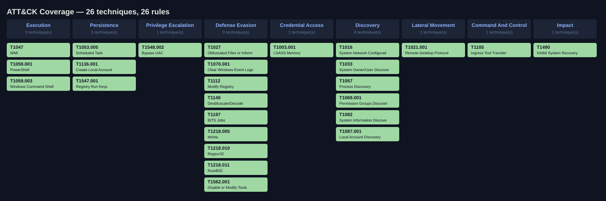

# Detection-as-Code: Sigma rules with built-in attack emulation & CI

[](https://github.com/mahendraa5157/detection-as-code/actions/workflows/ci.yml)


A library of **Windows Sigma detection rules**, each one shipped as a complete unit:
the rule, the **Atomic Red Team** test that triggers it, **positive and benign-negative
unit tests** against sample Sysmon logs, honest **false-positive notes**, and a
**CI pipeline** that validates every rule on each push.

## Why this exists

Most "SOC home lab" portfolios stop at *"I installed Splunk, ran an atomic, and saw an
alert once."* That proves a tool works — not that **you** can engineer detections.

This repo is built like a real detection-engineering workflow:

- **Rules are code.** Every rule is version-controlled, linted, syntax-checked, and
  compiled to a backend (Elasticsearch) in CI. A rule that doesn't parse or is missing
  required metadata **fails the build**.
- **Every rule is tested two ways.** It must fire on the malicious sample **and stay
  silent on a hand-crafted benign lookalike** (e.g. legitimate `certutil -hashfile` vs
  malicious `certutil -urlcache` download). That benign-negative test is where
  false-positive engineering actually happens.
- **Tuning is real, not copy-pasted.** Rules include exclusions for known-noisy
  behaviour (vendor updater scheduled tasks, SystemSettings children of `fodhelper`,
  `certutil` hashing, etc.) instead of mirroring the upstream SigmaHQ rule verbatim.
- **False positives are documented per rule** with a *justified* confidence level, not
  just `level: high`.
- **Coverage is generated, not claimed.** The ATT&CK heatmap is produced by a script
  that scans the rule tags, so it can never drift from what's actually implemented.

## ATT&CK coverage



- **Live layer:** import [`mappings/attack_navigator_layer.json`](mappings/attack_navigator_layer.json)
  into the [MITRE ATT&CK Navigator](https://mitre-attack.github.io/attack-navigator/)
  (*Open Existing Layer → Upload from local*).
- **Full table:** [`docs/coverage_summary.md`](docs/coverage_summary.md)

## Rule catalogue

26 rules spanning Execution, Persistence, Privilege Escalation, Defense Evasion,
Credential Access, Discovery, Lateral Movement, Command & Control, and Impact.

| Technique | Rule | File | Atomic | FP Notes | Severity |
|---|---|---|---|---|---|
| T1047 | WMI Process Creation Via Wmic | [`T1047_wmi_process_create.yml`](rules/windows/process_creation/T1047_wmi_process_create.yml) | `T1047-1` | [notes](docs/false_positives/T1047_wmi_process_create.md) | medium |
| T1059.001 | PowerShell Offensive Tooling / Encoded Commands | [`T1059_001_powershell_offensive.yml`](rules/windows/process_creation/T1059_001_powershell_offensive.yml) | `T1059.001-1` | [notes](docs/false_positives/T1059_001_powershell_offensive.md) | high |
| T1059.003 | Command Shell Child Of Office App | [`T1059_003_windows_command_shell.yml`](rules/windows/process_creation/T1059_003_windows_command_shell.yml) | `T1059.003-1` | [notes](docs/false_positives/T1059_003_windows_command_shell.md) | medium |
| T1053.005 | Scheduled Task Creation Via Schtasks | [`T1053_005_scheduled_task_creation.yml`](rules/windows/process_creation/T1053_005_scheduled_task_creation.yml) | `T1053.005-1` | [notes](docs/false_positives/T1053_005_scheduled_task_creation.md) | medium |
| T1136.001 | Local Account Creation Via Net User | [`T1136_001_create_local_account.yml`](rules/windows/process_creation/T1136_001_create_local_account.yml) | `T1136.001-1` | [notes](docs/false_positives/T1136_001_create_local_account.md) | medium |
| T1547.001 | Registry Run Key Persistence | [`T1547_001_registry_run_key.yml`](rules/windows/registry_set/T1547_001_registry_run_key.yml) | `T1547.001-1` | [notes](docs/false_positives/T1547_001_registry_run_key.md) | medium |
| T1548.002 | UAC Bypass Via Fodhelper | [`T1548_002_uac_bypass_fodhelper.yml`](rules/windows/process_creation/T1548_002_uac_bypass_fodhelper.yml) | `T1548.002-3` | [notes](docs/false_positives/T1548_002_uac_bypass_fodhelper.md) | high |
| T1027 | Obfuscated PowerShell (Stacked Flags) | [`T1027_obfuscated_powershell_flags.yml`](rules/windows/process_creation/T1027_obfuscated_powershell_flags.yml) | `T1027-1` | [notes](docs/false_positives/T1027_obfuscated_powershell_flags.md) | medium |
| T1070.001 | Clear Windows Event Logs | [`T1070_001_clear_event_logs.yml`](rules/windows/process_creation/T1070_001_clear_event_logs.yml) | `T1070.001-1` | [notes](docs/false_positives/T1070_001_clear_event_logs.md) | high |
| T1112 | Registry Tampering To Disable Security | [`T1112_modify_registry_disable_security.yml`](rules/windows/process_creation/T1112_modify_registry_disable_security.yml) | `T1112-1` | [notes](docs/false_positives/T1112_modify_registry_disable_security.md) | high |
| T1140 | Deobfuscate/Decode Via Certutil | [`T1140_deobfuscate_certutil_decode.yml`](rules/windows/process_creation/T1140_deobfuscate_certutil_decode.yml) | `T1140-1` | [notes](docs/false_positives/T1140_deobfuscate_certutil_decode.md) | medium |
| T1197 | BITS Job Download / Persistence | [`T1197_bits_jobs.yml`](rules/windows/process_creation/T1197_bits_jobs.yml) | `T1197-1` | [notes](docs/false_positives/T1197_bits_jobs.md) | medium |
| T1218.005 | Mshta Remote / Inline Script | [`T1218_005_mshta_execution.yml`](rules/windows/process_creation/T1218_005_mshta_execution.yml) | `T1218.005-1` | [notes](docs/false_positives/T1218_005_mshta_execution.md) | high |
| T1218.010 | Regsvr32 Squiblydoo | [`T1218_010_regsvr32_scrobj.yml`](rules/windows/process_creation/T1218_010_regsvr32_scrobj.yml) | `T1218.010-1` | [notes](docs/false_positives/T1218_010_regsvr32_scrobj.md) | high |
| T1218.011 | Rundll32 Proxy Execution | [`T1218_011_rundll32_proxy_exec.yml`](rules/windows/process_creation/T1218_011_rundll32_proxy_exec.yml) | `T1218.011-1` | [notes](docs/false_positives/T1218_011_rundll32_proxy_exec.md) | medium |
| T1562.001 | Disable Microsoft Defender | [`T1562_001_disable_defender.yml`](rules/windows/process_creation/T1562_001_disable_defender.yml) | `T1562.001-1` | [notes](docs/false_positives/T1562_001_disable_defender.md) | high |
| T1003.001 | LSASS Memory Dump | [`T1003_001_lsass_memory_dump.yml`](rules/windows/process_creation/T1003_001_lsass_memory_dump.yml) | `T1003.001-1` | [notes](docs/false_positives/T1003_001_lsass_memory_dump.md) | high |
| T1016 | Network Config Discovery | [`T1016_system_network_config_discovery.yml`](rules/windows/process_creation/T1016_system_network_config_discovery.yml) | `T1016-1` | [notes](docs/false_positives/T1016_system_network_config_discovery.md) | low |
| T1033 | System Owner/User Discovery | [`T1033_system_owner_user_discovery.yml`](rules/windows/process_creation/T1033_system_owner_user_discovery.yml) | `T1033-1` | [notes](docs/false_positives/T1033_system_owner_user_discovery.md) | low |
| T1057 | Process Discovery | [`T1057_process_discovery.yml`](rules/windows/process_creation/T1057_process_discovery.yml) | `T1057-1` | [notes](docs/false_positives/T1057_process_discovery.md) | low |
| T1069.001 | Local Permission Group Discovery | [`T1069_001_local_group_discovery.yml`](rules/windows/process_creation/T1069_001_local_group_discovery.yml) | `T1069.001-1` | [notes](docs/false_positives/T1069_001_local_group_discovery.md) | low |
| T1082 | System Information Discovery | [`T1082_system_information_discovery.yml`](rules/windows/process_creation/T1082_system_information_discovery.yml) | `T1082-1` | [notes](docs/false_positives/T1082_system_information_discovery.md) | low |
| T1087.001 | Local Account Discovery | [`T1087_001_local_account_discovery.yml`](rules/windows/process_creation/T1087_001_local_account_discovery.yml) | `T1087.001-1` | [notes](docs/false_positives/T1087_001_local_account_discovery.md) | low |
| T1021.001 | RDP Enabled Via Registry | [`T1021_001_rdp_enable.yml`](rules/windows/process_creation/T1021_001_rdp_enable.yml) | `T1021.001-1` | [notes](docs/false_positives/T1021_001_rdp_enable.md) | medium |
| T1105 | Ingress Tool Transfer (Certutil/BITS) | [`T1105_ingress_tool_transfer_certutil.yml`](rules/windows/process_creation/T1105_ingress_tool_transfer_certutil.yml) | `T1105-1` | [notes](docs/false_positives/T1105_ingress_tool_transfer_certutil.md) | high |
| T1490 | Inhibit System Recovery | [`T1490_inhibit_system_recovery.yml`](rules/windows/process_creation/T1490_inhibit_system_recovery.yml) | `T1490-1` | [notes](docs/false_positives/T1490_inhibit_system_recovery.md) | high |

## How the pieces fit together

```
rules/windows/<category>/<Txxxx_name>.yml   Sigma rule  (source of truth)
emulation/<Txxxx>/atomic_test_mapping.yml   which Atomic Red Team test triggers it
tests/sample_malicious_logs/<id>_malicious.json   event that SHOULD fire the rule
tests/sample_benign_logs/<id>_benign.json         lookalike that must NOT fire
docs/false_positives/<id>.md                 FP analysis + tuning + confidence
```

Rule files and folders are named after their ATT&CK technique ID, which is what makes
the coverage heatmap generation trivial and tamper-proof.

## Running it locally

```bash
python -m venv venv
venv\Scripts\activate           # Windows   (source venv/bin/activate on Linux/macOS)
pip install -r requirements.txt
```

```bash
python -m pytest tests/ -q
```

```bash
python scripts/run_sigma_validate.py
```

```bash
python scripts/build_coverage_heatmap.py
```

Convert any rule to your SIEM's query language with `sigma-cli`:

```bash
sigma convert -t elasticsearch -p sysmon rules/windows/process_creation/T1003_001_lsass_memory_dump.yml
```

## Emulation & log-sample provenance

Sample logs are tied to the mapped [Atomic Red Team](https://github.com/redcanaryco/atomic-red-team)
tests and carry a `_provenance` field:

- **`real-capture`** — exported from **Sysmon** on a Windows 10 VirtualBox lab VM after
  actually running the atomic with `Invoke-AtomicTest`, then sanitized (lab
  hostname/user) and curated to the triggering event. Currently 6 techniques
  (T1003.001, T1053.005, T1059.001, T1105, T1218.010, T1490) — e.g. a genuine
  `rundll32 comsvcs.dll MiniDump` against LSASS and a real PowerSploit download cradle.
- **`synthetic`** — authored field-for-field from the atomic's documented command line.
  Used where the technique's atomic performs its action **in-process** (e.g. PowerShell
  `Clear-EventLog` / `Set-MpPreference` spawn no child process, so there is no distinct
  Sysmon process-creation event to capture) or where running the live payload adds no
  signal beyond the command line the rule keys on.

`scripts/capture/` and `scripts/capture/Capture-AtomicLogs.ps1` automate this loop. It is:

1. Revert the lab VM to a clean Sysmon baseline snapshot.
2. Run the mapped atomic (`Invoke-AtomicTest Txxxx`).
3. Export the triggering Sysmon event(s), sanitize, and drop into `tests/sample_*_logs/`.
4. Craft a benign lookalike and confirm the rule stays silent.

## Tech stack

Sigma / pySigma · sigma-cli · Atomic Red Team · Sysmon · pytest · GitHub Actions ·
MITRE ATT&CK Navigator
